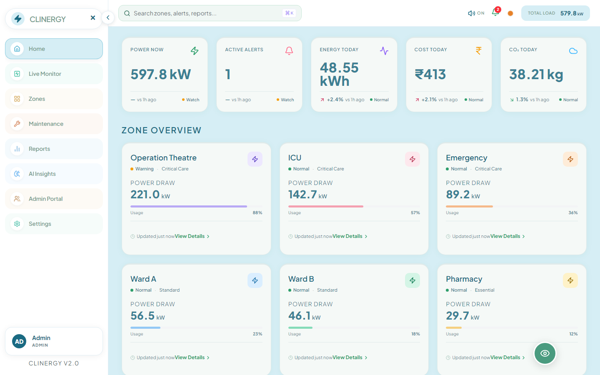
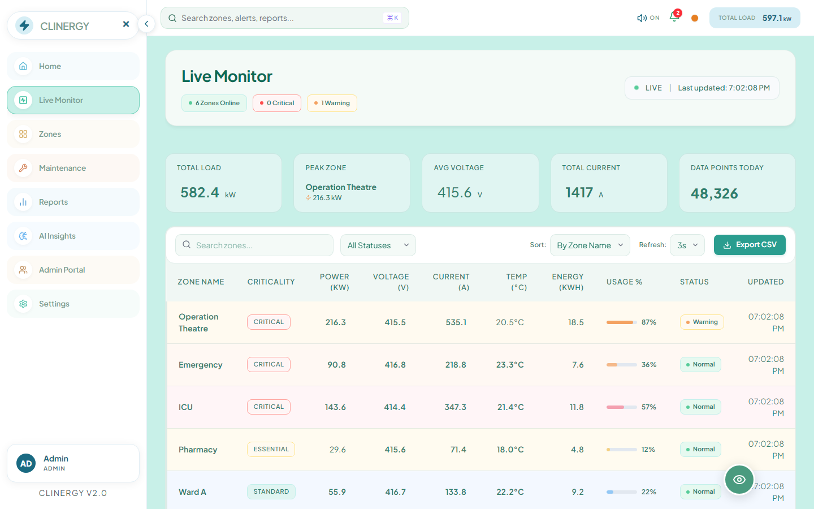
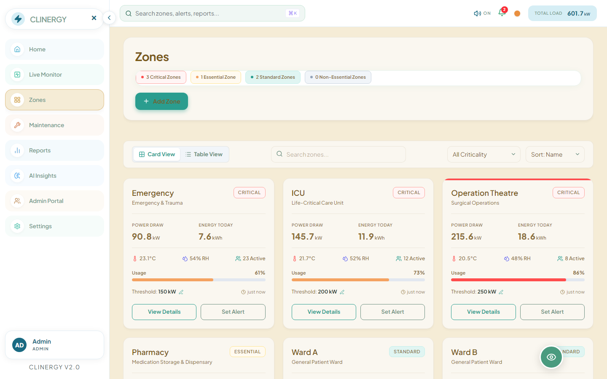
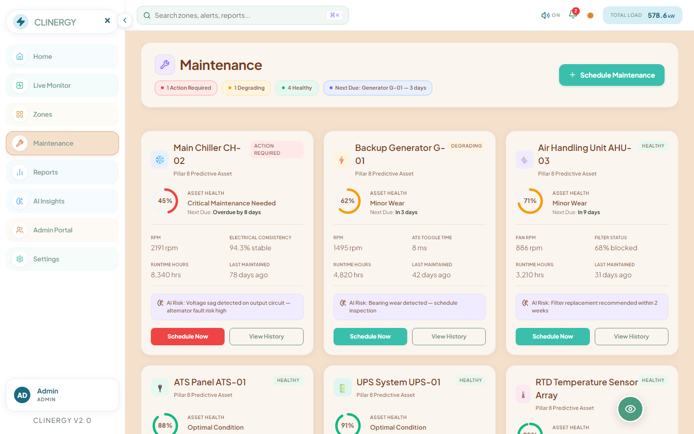
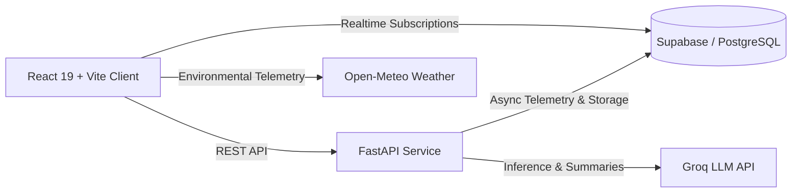

# CLINERGY — Clinical Energy & Intelligent Asset Management Platform

> An intelligent digital twin and clinical energy optimization platform for hospital networks, providing real-time telemetry, predictive asset maintenance, and ML-powered demand forecasting.

[](https://clinergy.vercel.app)
[](https://react.dev/)
[](https://www.typescriptlang.org/)
[](https://fastapi.tiangolo.com/)
[-6B9080?style=for-the-badge&logo=supabase&logoColor=white)](https://supabase.com/)

> **Demo Mode Enabled**: Direct instant access is configured for recruiters and evaluators. **No login needed** — all routes are accessible immediately.

---

## Application Screenshots

> *Add application captures to `docs/screenshots/` to display preview previews below:*

| Home Command Dashboard | Live Waveform Telemetry |
| :---: | :---: |
| <br>*(Placeholder: captures `01-home-dashboard.png`)* | <br>*(Placeholder: captures `02-live-monitor.png`)* |

| Zones & Inspection Drawer | Predictive Maintenance Registry |
| :---: | :---: |
| <br>*(Placeholder: captures `03-zones.png`)* | <br>*(Placeholder: captures `04-maintenance.png`)* |

---

## Core Pages & Capabilities

- **Home (`/`)**: Global KPI metrics (Power Now, Energy Today, Cost Today, Active Alerts, CO₂ Emissions), live zone status, power trend charts, and ambient weather/HVAC impact.
- **Live Monitor (`/live`)**: Sub-second telemetry stream across ICU, Operation Theatre, Emergency, Wards, and Pharmacy with wave indicators.
- **Zones (`/zones`)**: Clinical wing cards with interactive slide-out drawer displaying hero metrics, trend charts, historical logs, and AI actions.
- **Maintenance (`/maintenance`)**: Predictive equipment health scores for generators and chillers, failure degradation alerts, and work-order scheduling.
- **Reports (`/reports`)**: Compliance PDF and CSV report compilation with carbon analytics and date-range filters.
- **AI Insights (`/ai-insights`)**: ARIMA + LSTM demand forecasting, Isolation Forest anomaly detection, and curtailment thresholds.
- **Admin Portal (`/admin/users`)**: RBAC directory management (`Admin`, `Energy Manager`, `Zone Manager`, `Viewer`) with status toggles.
- **Settings (`/settings`)**: Localized electricity tariffs, safety alarm threshold limits, and accessibility options (read-aloud, high contrast).

---

## Tech Stack & Architecture

- **Frontend**: React 19, Vite, TypeScript, Tailwind CSS, Recharts, Framer Motion, Lucide Icons.
- **Backend Service**: Python 3.11, FastAPI, AsyncIO, Pydantic, ReportLab.
- **Database & Auth**: PostgreSQL via Supabase (Row-Level Security, Realtime Subscriptions).
- **AI & Forecasting**: Groq API (Llama 3.3) for clinical assistant; Scikit-Learn time-series models.
- **Telemetry Simulation**: Async data simulator broadcasting realistic clinical wing load variations.

### Architecture Flow


---

## Database Schema & Use Cases

- **ER Diagram**: [`docs/clinergy_er_diagram.png`](docs/clinergy_er_diagram.png)
- **Use-Case Diagram**: [`docs/clinergy_usecase_diagram.png`](docs/clinergy_usecase_diagram.png)

---

## Quick Start

1. **Clone & install dependencies**:
   ```bash
   git clone https://github.com/spoortibiradar8/Clinergy.git
   cd Clinergy
   npm install
   ```

2. **Configure environment**:
   ```bash
   cp .env.example .env
   # Add your Supabase credentials (keep VITE_REQUIRE_AUTH=false for demo mode)
   ```

3. **Start local development**:
   ```bash
   npm run dev
   ```
   Open [http://localhost:5173](http://localhost:5173).

---

## Repository Structure

```
CLINERGY/
├── docs/                      # Architectural diagrams, project report, screenshots
│   ├── clinergy_er_diagram.png
│   ├── clinergy_usecase_diagram.png
│   ├── CLINERGY_PROJECT_REPORT.md
│   ├── README.md
│   └── screenshots/
├── public/                    # Static assets & public manifest
├── src/                       # React frontend source code
│   ├── components/            # UI components, layout, and inspection drawer
│   ├── context/               # Accessibility, Auth, and Language providers
│   ├── hooks/                 # Custom telemetry and utility hooks
│   ├── pages/                 # Route page components
│   └── services/              # API and client-side calculations
├── backend/                   # FastAPI backend service
│   ├── routers/               # API endpoints
│   ├── services/              # ML forecasting and data simulator
│   ├── requirements.txt       # Python dependencies
│   └── README.md
├── .env.example               # Environment variables template
├── LICENSE                    # MIT License
└── package.json
```

---

## License

This project is licensed under the [MIT License](LICENSE).
