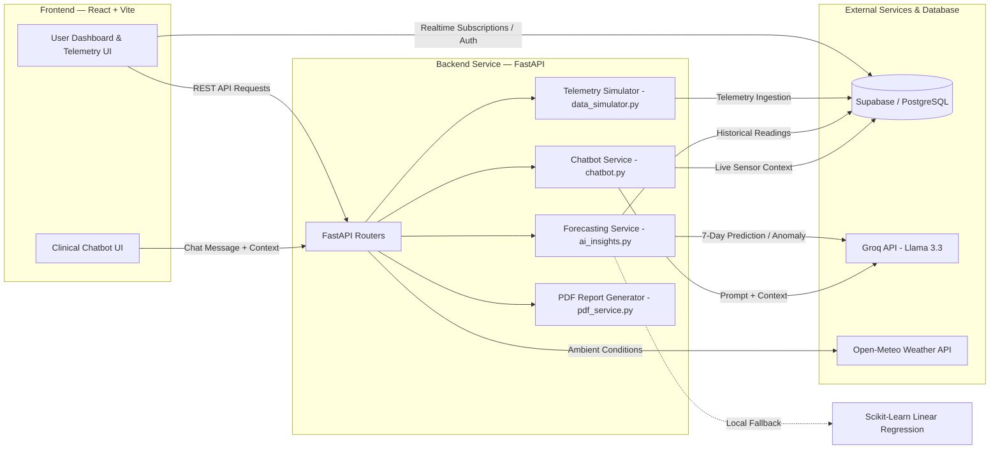

# CLINERGY

> An intelligent digital twin and clinical energy asset management platform for hospital networks, providing real-time telemetry monitoring, predictive equipment maintenance, and AI-driven demand forecasting.

[](https://github.com/spoortibiradar8/Clinergy/actions/workflows/ci.yml)
[](LICENSE)
[](https://clinergy.vercel.app)

**Live Demo:** [https://clinergy.vercel.app](https://clinergy.vercel.app)  
*(Demo mode enabled: instant access without login credentials)*

---

## Application Screenshots

| Home Command Dashboard | Live Waveform Telemetry |
| :---: | :---: |
|  |  |

| Zones & Inspection Drawer | Predictive Maintenance Registry |
| :---: | :---: |
|  |  |

---

## Features

- **Real-Time Clinical Telemetry:** Live sub-second monitoring of power (kW), temperature (°C), voltage, and operating status across critical hospital wings (ICU, OT, Emergency, Wards, Pharmacy).
- **Interactive Zone Analytics & Drawer:** Dynamic inspection drawer visualizing continuous power waveforms, peak demand thresholds, and historical energy logs per wing.
- **Predictive Asset Maintenance:** Equipment health scoring for chillers, generators, and UPS systems with degradation risk indicators and work-order scheduling.
- **AI Demand Forecasting & Tariff Analytics:** 7-day electrical load forecasting and anomaly detection implemented via Groq LLM (`llama-3.3-70b-versatile`) with Scikit-Learn `LinearRegression` fallback, alongside carbon footprint and peak/off-peak tariff cost calculations.
- **Context-Aware Clinical Assistant:** Embedded chatbot powered by FastAPI and Groq LLM (`llama-3.3-70b-versatile`) with live telemetry context injection and page-aware quick replies.
- **Compliance Reporting & Audit Export:** Server-side PDF generation via ReportLab alongside CSV telemetry export for environmental and hospital regulatory compliance.

---

## Tech Stack

### Frontend
- **Framework & Runtime:** React 19, TypeScript, Vite 8
- **Styling & UI:** Tailwind CSS 4, shadcn/ui component architecture, Framer Motion
- **Visualizations & Icons:** Recharts, Lucide React
- **Routing & State:** React Router 7, React Context (Auth, Theme, Accessibility, Language)
- **Data & Utilities:** Supabase JS Client, Papaparse, jsPDF

### Backend
- **Framework:** Python 3.11, FastAPI, Pydantic v2
- **Server:** Uvicorn (ASGI)
- **Data & Machine Learning:** Pandas, NumPy, Scikit-Learn (`LinearRegression` fallback)
- **Database & Realtime:** Supabase Python SDK (PostgreSQL)
- **AI & Integrations:** Groq API (`llama-3.3-70b-versatile`), HTTPX (async HTTP)
- **Reporting & Media:** ReportLab, Pillow

---

## Architecture

CLINERGY is built with a decoupled architecture pairing a high-performance React SPA with an asynchronous Python FastAPI service and Supabase (PostgreSQL). The frontend connects directly to Supabase for realtime telemetry subscriptions and authentication state, while dispatching API requests to the FastAPI backend for compute-intensive tasks. The FastAPI service executes an asynchronous background IoT simulator that ingests and evaluates zone sensor streams. When clinical staff interact with the AI assistant, the backend constructs a live system prompt containing current sensor readings, active alerts, and weather data before querying the Groq LLM API. PDF compliance reports are compiled server-side and streamed directly to the client.

### Architecture Flow



---

## Getting Started

### Prerequisites
- [Node.js](https://nodejs.org/) (v20+ recommended) and `npm`
- [Python](https://www.python.org/) (v3.11+) and `pip`
- [Git](https://git-scm.com/)

### 1. Clone the Repository
```bash
git clone https://github.com/spoortibiradar8/Clinergy.git
cd Clinergy
```

### 2. Frontend Setup
Install frontend dependencies:
```bash
npm install
```

Configure frontend environment variables:
```bash
cp .env.example .env
```

| Variable | Description | Default / Example |
| :--- | :--- | :--- |
| `VITE_SUPABASE_URL` | Supabase project URL for database connection | `https://your-project-id.supabase.co` |
| `VITE_SUPABASE_ANON_KEY` | Supabase anonymous public API key | `your-anon-key-placeholder` |
| `VITE_BACKEND_URL` | Base URL of the FastAPI backend service | `http://127.0.0.1:8000` |
| `VITE_REQUIRE_AUTH` | Set `false` for demo access without login; `true` for strict auth | `false` |

Start the frontend development server:
```bash
npm run dev
```
The application will be available at [http://localhost:5173](http://localhost:5173).

To build for production:
```bash
npm run build
```

### 3. Backend Setup

> **Note on Demo Mode:** When running in demo mode (`VITE_REQUIRE_AUTH=false`), the frontend runs standalone and does **not** require the backend to be running. The frontend includes built-in offline fallbacks and mock data for immediate evaluation. Starting the Python backend is optional, and is only required if you want live simulated telemetry generation, server-side ReportLab PDF generation, and backend Groq chat routing.

Navigate into the backend directory and set up a virtual environment:
```bash
cd backend
python -m venv venv
```

Activate the virtual environment:
- **Windows (PowerShell):**
  ```powershell
  .\venv\Scripts\Activate.ps1
  ```
- **macOS / Linux:**
  ```bash
  source venv/bin/activate
  ```

Install dependencies:
```bash
pip install -r requirements.txt -r requirements-dev.txt
```

Configure backend environment variables:
```bash
cp .env.example .env
```

| Variable | Description | Default / Example |
| :--- | :--- | :--- |
| `SUPABASE_URL` | Supabase project URL for server-side database operations | `https://your-project-id.supabase.co` |
| `SUPABASE_ANON_KEY` | Supabase anonymous API key for backend ingestion | `your-anon-key-placeholder` |
| `GROQ_API_KEY` | Groq API key for LLM-powered chatbot & predictions | `gsk_your_groq_api_key` |
| `SIMULATOR_INTERVAL_SECONDS` | Interval in seconds between IoT telemetry ticks | `10` |
| `FRONTEND_ORIGIN` | Allowed origin for Cross-Origin Resource Sharing (CORS) | `http://localhost:5173` |

Start the FastAPI backend server:
```bash
uvicorn main:app --reload --port 8000
```
- Interactive API documentation (Swagger UI): [http://localhost:8000/docs](http://localhost:8000/docs)
- Alternative API documentation (ReDoc): [http://localhost:8000/redoc](http://localhost:8000/redoc)
- Health check endpoint: [http://localhost:8000/health](http://localhost:8000/health)

---

## Project Structure

```
CLINERGY/
├── .github/workflows/         # CI/CD workflows (lint, build, test)
├── backend/                   # FastAPI backend service
│   ├── database/              # Supabase database client singleton
│   ├── routers/               # FastAPI route handlers (zones, alerts, chatbot, reports)
│   ├── schemas/               # Pydantic request/response validation models
│   ├── services/              # Business logic, IoT telemetry simulator, LLM chatbot
│   ├── tests/                 # Backend pytest test suite
│   ├── config.py              # Pydantic application settings
│   ├── main.py                # FastAPI entry point & lifespan management
│   ├── requirements.txt       # Production Python dependencies
│   └── requirements-dev.txt   # Development & test Python dependencies
├── docs/                      # Architectural diagrams and documentation assets
│   ├── clinergy_er_diagram.png       # Database Entity-Relationship diagram
│   ├── clinergy_usecase_diagram.png  # System use case diagram
│   └── screenshots/           # Application preview captures
├── public/                    # Static assets & public web manifest
├── src/                       # Frontend source code (React 19 + TypeScript)
│   ├── components/            # UI components, layout, and inspection drawer
│   ├── context/               # Accessibility, Auth, and Language providers
│   ├── hooks/                 # Custom telemetry and utility hooks
│   ├── pages/                 # Route page views (Home, Live, Zones, Maintenance, Reports)
│   ├── services/              # API and client-side calculations
│   └── types/                 # TypeScript interfaces and data models
├── .env.example               # Template for frontend environment variables
├── package.json               # Frontend dependencies and npm scripts
├── vercel.json                # Single-page application route rewrite configuration
└── vite.config.ts             # Vite configuration with React plugin
```

---

## Testing

Run the backend test suite with `pytest`:

```bash
cd backend
pytest
```

---

## Future Improvements

1. **Advanced Time-Series Models:** ARIMA, LSTM and Isolation Forest for demand forecasting and anomaly detection.
2. **Hardware IoT Gateway Integration:** Ingest live readings from industrial Modbus/BACnet energy meters via MQTT brokers for physical facility deployment.
3. **Automated Demand Response & Peak Shaving:** Programmatic control signals communicating directly with hospital HVAC chillers and variable frequency drives (VFDs).
4. **Air-Gapped Local LLM Inference:** Option to deploy quantized open-source models (e.g. Llama-3 via vLLM/Ollama) on hospital premises for HIPAA/data privacy air-gapped compliance.

---

## License & Contact

Distributed under the [MIT License](LICENSE).

**Author:** Spoorti Biradar  
**GitHub Profile:** [https://github.com/spoortibiradar8](https://github.com/spoortibiradar8)  
**Email:** TODO  
**LinkedIn:** TODO
